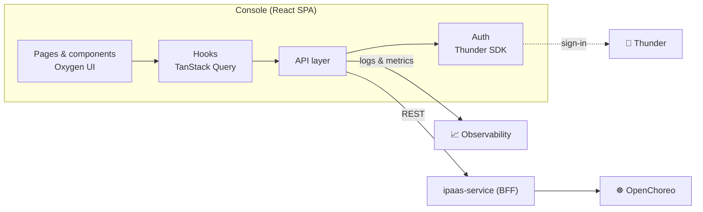

<div align="center">

# WSO2 Integration Platform Console

**Build, deploy, test and observe integrations on WSO2 Cloud from one place in the browser.**


[Developer guide](ipaas/README.md) · [Architecture](ipaas/docs/architecture.md) · [End-to-end tests](ipaas/tests/e2e/README.md) · [Agent instructions](ipaas/AGENTS.md)

</div>

---

## What it does

The console is where WSO2 Cloud users work with their integrations:

|                         |                                                                                                                                                            |
| ----------------------- | ---------------------------------------------------------------------------------------------------------------------------------------------------------- |
| **Create**           | Start from a sample, a prebuilt integration or the AI Integration Builder, or import an existing repository from GitHub, GitLab, Bitbucket or Azure DevOps |
| **Build and deploy** | Follow builds, deploy to environments and promote releases through deployment pipelines                                                                    |
| **Test**             | Call APIs from the built-in test console, chat with AI agents and try MCP servers                                                                          |
| **Observe**          | Read runtime logs and metrics at organization, project and integration level                                                                               |
| **Operate**          | Manage environments, configuration and secrets, containers and health checks                                                                               |

Supported integration types include APIs, automations, event and file integrations, webhooks, AI agents and MCP servers. Each one gets an overview page tailored to its type.

---

## A look at the UI

Everything is organized in three levels: **organization → project → integration**. The header shows where you are, and the sidebar changes with the level.

```text
┌────────────────────────────────────────────────────────────────────────────┐
│ ☰  WSO2  │  Organization ▾  ›  Project ▾  ›  Integration ▾      ◐   User ▾ │
├──────────────────┬─────────────────────────────────────────────────────────┤
│ ▣ Overview       │                                                         │
│                  │   Integration overview                                  │
│ Build            │   ┌──────────────────┐     ┌──────────────────┐         │
│ Deploy           │   │ Development      │ ──► │ Production       │         │
│ Test             │   │ ● Active   v1.4  │     │ ● Active   v1.3  │         │
│ Observe        ▾ │   │ Endpoints · Logs │     │ Endpoints · Logs │         │
│    Runtime Logs  │   └──────────────────┘     └──────────────────┘         │
│    Metrics       │   environment cards, promotion between them             │
│ Operate        ▾ │                                                         │
│ Infrastructure ▾ │                                                         │
│    Environments  │                                                         │
│    Pipelines     │                                                         │
├──────────────────┴─────────────────────────────────────────────────────────┤
│ Documentation · Support · Terms of Use · Privacy Policy     © WSO2 LLC.    │
└────────────────────────────────────────────────────────────────────────────┘
```

| Level            | Home page                                                  | Sidebar                                                                                    |
| ---------------- | ---------------------------------------------------------- | ------------------------------------------------------------------------------------------ |
| **Organization** | Projects in the organization                               | Overview, Build, Deploy, Test, Observe, Infrastructure (environments, pipelines), Settings |
| **Project**      | Project overview: integrations, architecture, contributors | The same areas, scoped to the project                                                      |
| **Integration**  | Environment cards for that integration                     | Adds **Operate**: runtime, containers, configs and secrets, health checks                  |

> [!TIP]
> Every page has a stable URL under `/organizations/<org>/…`, so any view can be bookmarked or shared with a teammate in the same organization.

---

## How the frontend is built



- **One backend.** Almost every request goes to `ipaas-service`, a backend-for-frontend that turns OpenChoreo resources into the shapes the console needs.
- **Signed in with Thunder.** The WSO2 Cloud identity provider. Each session is scoped to one organization.
- **Server state in TanStack Query.** Caching, refetching and polling for builds and deployments, with no global client store.
- **Oxygen UI.** WSO2's design system on top of MUI, including the app shell, navigation, charts and icons. Light and dark themes are built in.
- **Configured at runtime.** Backend URLs come from a `config.json` loaded at startup, so the same build runs in every environment.
- **Clear layering.** Pages → hooks → API → auth, enforced by ESLint. Features still waiting for backend support are kept apart in `src/unported/` until they are ported.

> [!NOTE]
> The full picture, including every service the console talks to, is in [docs/architecture.md](ipaas/docs/architecture.md).

---

## Repository layout

```text
.
├── ipaas/                 The console: source, tests, Dockerfiles, docs
│   ├── src/               Application code
│   ├── tests/e2e/         Playwright end-to-end suite
│   └── docs/              Architecture and runtime configuration
├── .github/workflows/     Pull request checks (unit tests)
├── AGENTS.md              Entry point for coding agents
└── CLAUDE.md              Loads the AGENTS.md files for Claude Code
```

---

## Get started

```bash
cd ipaas
pnpm install
pnpm build
```

> [!IMPORTANT]
> To try the console in a browser, run it inside the local WSO2 Cloud stack. Follow the **[local setup guide](https://docs.google.com/document/d/1El3uqR674ZDjLfbEP3VSQZgGxYjQMK0kfxQakc9Lh_s)**, then continue with the [developer guide](ipaas/README.md).

---

## Working with coding agents

Rules and conventions for code changes live in `AGENTS.md` files: one at the root, one in `ipaas/`, and one in each folder with rules of its own. Claude Code, Codex, Cursor and other agents read them automatically, and they are a quick reference for people too.
