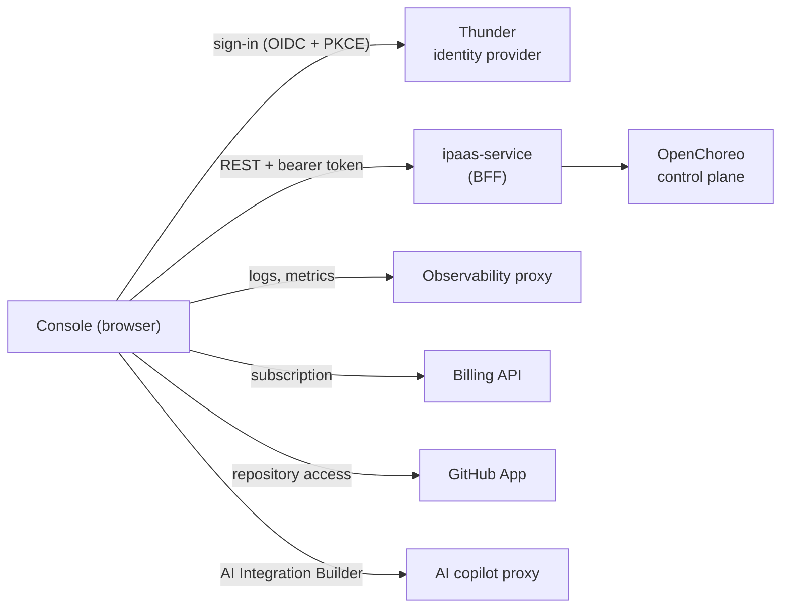

# Architecture

The console is a single-page React application. It holds no server code of its own: it is built into static files, served by nginx, and talks to the WSO2 Cloud platform from the browser.



## Parts

**Console.** This repository. `pnpm build` produces static files, and the `Dockerfile` serves them with nginx. On startup the console fetches `/config.json` for its backend URLs, so one image runs in every environment (see [runtime-config.md](runtime-config.md)).

**Thunder.** The WSO2 Cloud identity provider. Users sign in on Thunder's hosted page (Google or GitHub), and the Thunder SDK manages the tokens in the browser. Each access token is scoped to one organization, chosen at sign-in. Thunder also creates the organization when a user signs up.

**ipaas-service (BFF).** The backend-for-frontend. Almost every console request goes to it:

- projects, integrations, builds, deployments, environments and configuration;
- for each request, it calls the OpenChoreo control plane and returns shapes the console understands.

The BFF is the console's API contract. When the console needs data the BFF does not provide, the BFF has to change first.

**Observability proxy.** Logs and metrics are queried directly from the WSO2 Cloud observability proxy, not through the BFF.

**Other services.**

- **Billing API:** activates and reads the organization's subscription.
- **GitHub App:** gives access to private repositories when an integration is created from source.
- **AI copilot proxy:** serves the AI Integration Builder.
- **GitHub raw files:** the samples and prebuilt-integration catalogs are public data loaded from there.

## Inside the console

```
routes (src/config/routes.tsx)
  └─ layouts: ProtectedRoute → AppLayout (signed-in shell, navigation)
       └─ pages (src/pages)
            └─ components
                 └─ hooks (TanStack Query, src/hooks)
                      └─ api (src/api) ─→ BFF / observability proxy
                           └─ auth (src/auth) — bearer token from the Thunder SDK
```

- **Scopes.** Navigation follows three levels: organization, project and integration. `src/nav.ts` models these scopes. It holds the navigation for each level and builds the URLs, all under `/organizations/:org/`.
- **Server state.** Server state lives in TanStack Query. There is no global client store; small cross-cutting concerns use narrow React contexts (`src/contexts/`).
- **Unported features.** Features whose backend is not available yet are kept in `src/unported/`. They have no routes and are not part of the running app until they are ported.

## Environments

| Environment       | Console                                                        | Notes                                                                                                        |
| ----------------- | -------------------------------------------------------------- | ------------------------------------------------------------------------------------------------------------ |
| Local stack (k3d) | Deployed into the local cluster                                | See the [local setup guide](https://docs.google.com/document/d/1El3uqR674ZDjLfbEP3VSQZgGxYjQMK0kfxQakc9Lh_s) |
| Development       | `https://ipaas-console-development.gateway.dev.cloud.wso2.com` | Target of the end-to-end suite by default                                                                    |

Each environment mounts its own `config.json` through the console's release binding in the deployment repository.
