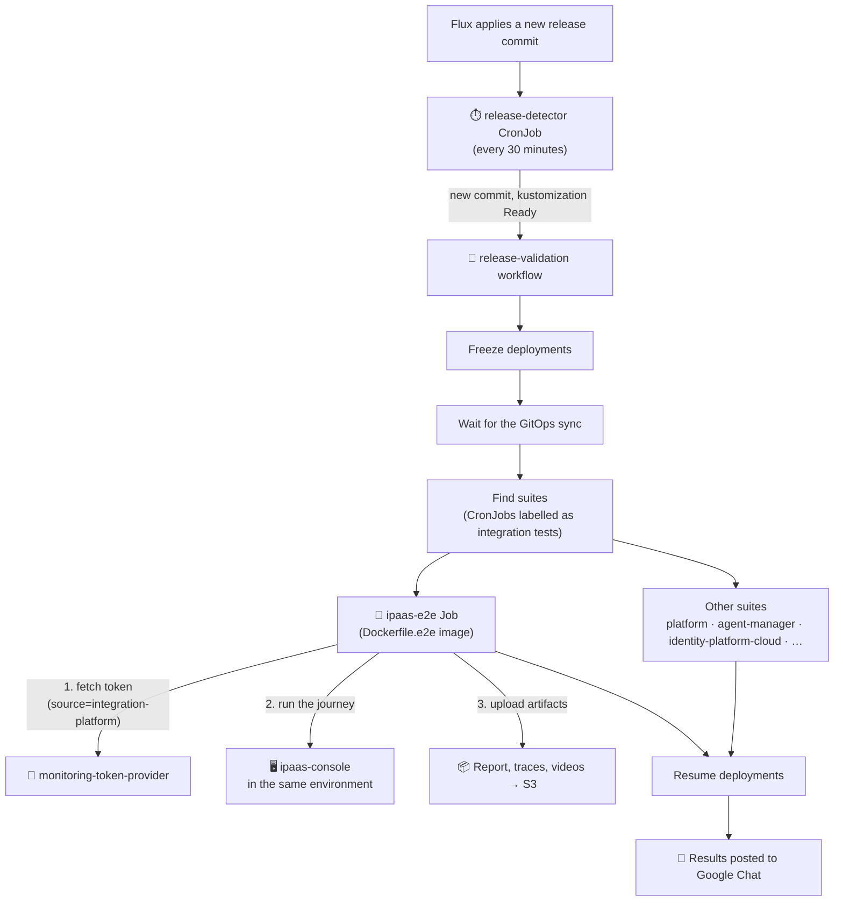

# End-to-end tests

Playwright tests for the integration platform console. They drive a **deployed** console in a real browser and sign in through Thunder, just like a user would.

The suite runs in two places:

| Where                             | When                                 | Signs in with       |
| --------------------------------- | ------------------------------------ | ------------------- |
| **WSO2 Cloud release validation** | Automatically, for every new release | A platform token    |
| **Your machine**                  | Whenever you run it                  | GitHub bot or token |

> [!NOTE]
> The suite never starts a console of its own. It always tests one that is already deployed. By default that is the development environment at `https://ipaas-console-development.gateway.dev.cloud.wso2.com`.

---

## What the suite covers

| Project      | Spec                                    | Needs a session |
| ------------ | --------------------------------------- | --------------- |
| `cloud-anon` | `specs/cloud-anon/login.spec.ts`        | No              |
| `cloud`      | `specs/cloud/ipaas-e2e-journey.spec.ts` | Yes             |

**`cloud-anon`** checks the sign-in page: the hand-off to Thunder, the offered identity providers, and the policy links.

**`cloud`** is one journey through the console, in numbered groups:

| Group   | What it checks                                                                      |
| ------- | ----------------------------------------------------------------------------------- |
| 00      | Removes the suite's leftover project from older runs                                |
| 01      | Creates the run's own fixture project                                               |
| 02      | Empty project overview                                                              |
| 03      | Browsing samples                                                                    |
| 04–04d  | Deploying a sample; endpoints and consumers; the test console; scheduled automation |
| 05      | Importing an AI agent from a public repository                                      |
| 06      | Populated project overview                                                          |
| 07      | Page availability (logs, metrics, settings) at every level                          |
| 08, 08b | Deletes the fixture project; sweeps projects abandoned by other runs                |
| 09      | Sign out                                                                            |

> [!TIP]
> Each run works in its own project, `IPAAS-E2E-<date-time>-<suffix>`, and deletes it at the end. Two runs can overlap without getting in each other's way.

---

## Signing in: two setups

The `cloud` project needs a signed-in session. One of two setup projects creates it before any test starts:

| Setup               | Used when               | How it signs in                                                                                          |
| ------------------- | ----------------------- | -------------------------------------------------------------------------------------------------------- |
| `setup-cloud`       | Default                 | Signs in on Thunder's page with a GitHub bot account, answering GitHub's second factor if asked          |
| `setup-cloud-token` | `E2E_TOKEN_MODE` is set | Builds the session from a token issued by the platform's `monitoring-token-provider`; no browser sign-in |

Both save the session in `.auth/`. The tests behave the same with either.

---

## How it runs in WSO2 Cloud

In WSO2 Cloud the suite is one of the **release validation** suites. The pipeline is defined in the `wso2cloud-deployment` repository. Every time a new release is applied to an environment, the pipeline runs all registered suites against it, and this one runs alongside the platform, Agent Manager and identity suites. The platform and Agent Manager suites test APIs and are written in Go; `ipaas-e2e` and `identity-platform-cloud` are the Playwright browser suites.



How it works:

1. **Detect.** The `release-detector` CronJob checks every 30 minutes whether Flux has applied a commit that has not been validated yet. When it has, it starts a `release-validation` workflow for that commit.
2. **Freeze.** The workflow freezes deployments and waits until the environment is in sync with the commit, so nothing changes under the tests.
3. **Run.** It finds every suite (each one a suspended CronJob in the `tests` namespace) and runs them all in parallel as Jobs. `ipaas-e2e` is one of them.
4. **Sign in with a token.** The `ipaas-e2e` Job runs in token mode. It fetches a token for the console's client from `monitoring-token-provider`, so no GitHub credentials ever reach the cluster.
5. **Report.** Playwright writes its report, a JUnit file (`junit/junit.xml`), traces and videos to `/artifacts`, and an uploader ships them to S3. When every suite has finished, deployments resume and a summary with a row per suite is posted to Google Chat.

> [!IMPORTANT]
> The Job has a two-hour deadline. Group 08b only removes projects older than two hours, so it can never delete the project of a run that is still going.

The Job's settings, from the `ipaas-e2e` CronJob in `wso2cloud-deployment`:

| Variable                 | Value                                                                        |
| ------------------------ | ---------------------------------------------------------------------------- |
| `E2E_TOKEN_MODE`         | `1`                                                                          |
| `E2E_TOKEN_URL`          | The environment's `monitoring-token-provider`, `source=integration-platform` |
| `E2E_TOKEN_AUTH`         | From the `test-secrets` secret                                               |
| `E2E_TOKEN_TLS_INSECURE` | `1` (the internal gateway's certificate does not match its name)             |
| `E2E_CLOUD_BASE_URL`     | The console in the same environment                                          |
| `E2E_ARTIFACT_DIR`       | `/artifacts`                                                                 |
| `PW_WORKERS`             | `2`                                                                          |

---

## Running the suite locally

### 1. Install

```bash
cd ipaas
pnpm install
pnpm exec playwright install --with-deps chromium
```

### 2. Configure

```bash
cp .env.test.example .env.test
```

Fill in `.env.test` for the setup you want to use. The example file explains every variable.

**GitHub sign-in (`setup-cloud`)**

| Variable                                                        | Purpose                                                                     |
| --------------------------------------------------------------- | --------------------------------------------------------------------------- |
| `E2E_GITHUB_USERNAME`, `E2E_GITHUB_PASSWORD`                    | The bot's GitHub account                                                    |
| `E2E_GITHUB_TOTP_SECRET`                                        | Only if the bot has authenticator-app two-factor enabled                    |
| `GMAIL_CLIENT_ID`, `GMAIL_CLIENT_SECRET`, `GMAIL_REFRESH_TOKEN` | Reads GitHub's emailed verification code when the bot has no two-factor app |

Create the Gmail refresh token once with `pnpm test:e2e:get-gmail-token`.

> [!WARNING]
> Keep the bot account out of all GitHub organizations. An organization that requires two-factor authentication removes the emailed-code path, and the sign-in stops working.

**Platform token (`setup-cloud-token`)**

| Variable                 | Purpose                                                            |
| ------------------------ | ------------------------------------------------------------------ |
| `E2E_TOKEN_MODE`         | Set to `1` to use this setup                                       |
| `E2E_TOKEN_URL`          | The token provider endpoint                                        |
| `E2E_TOKEN_AUTH`         | Shared secret for the token provider                               |
| `E2E_TOKEN_TLS_INSECURE` | Set to `1` when the provider's certificate does not match its host |

**Either setup**

| Variable             | Purpose                                                  |
| -------------------- | -------------------------------------------------------- |
| `E2E_CLOUD_BASE_URL` | Console to test. Defaults to the development environment |
| `E2E_PROJECT`        | Reuse an existing project instead of creating one        |

### 3. Run

```bash
pnpm test:e2e                       # full suite (cloud-anon + cloud)
pnpm test:e2e:anon                  # sign-in page only, no credentials needed
pnpm test:e2e -g "07 page"          # one group or test by name
pnpm test:e2e --headed              # watch the browser
pnpm test:e2e:ui                    # Playwright UI mode
pnpm test:e2e:report                # open the last HTML report
```

> [!TIP]
> No credentials yet? `pnpm test:e2e:anon` checks that the console is reachable and its sign-in page works.

A failed test keeps a trace, a video and a screenshot under `test-results/`. Open the trace first; it shows the page at the moment of failure:

```bash
pnpm exec playwright show-trace test-results/<test>/trace.zip
```

### Running the container image locally

The same image the release pipeline uses can run on your machine:

```bash
cd ipaas
docker build -f Dockerfile.e2e -t ipaas-e2e:local .
docker run --rm --env-file .env.test --shm-size=1g ipaas-e2e:local
```

- The image contains only `playwright.config.ts`, `tests/` and a browser. It builds no frontend.
- `--shm-size=1g` is required: Chromium crashes with the default 64 MB of shared memory.
- The image sets `CI=true`, so a run uses two retries and a single worker unless `PW_WORKERS` says otherwise.
- The test process is the container's main process, so its exit code is the run's result.

---

## Credentials and artifacts

> [!CAUTION]
> `.env.test` and `.auth/` hold live credentials. Never commit them, share them or attach them to a report.

- **Setup runs record nothing.** The setup projects keep no trace, video or screenshot, because a sign-in trace contains tokens. Set `E2E_SETUP_ARTIFACTS=1` only to debug a broken sign-in, and treat the output as secret.
- **Test traces contain the bearer token** in request headers. Keep reports internal and short-lived.

---

## Troubleshooting

| Symptom                                                   | Likely cause                                        | Fix                                                                     |
| --------------------------------------------------------- | --------------------------------------------------- | ----------------------------------------------------------------------- |
| `E2E_GITHUB_USERNAME and E2E_GITHUB_PASSWORD must be set` | `.env.test` missing or incomplete                   | Fill in the GitHub sign-in variables, or run `pnpm test:e2e:anon`       |
| Setup stops on a GitHub screen                            | GitHub asked for a factor the setup cannot answer   | Run with `--headed`. Remove a passkey from the bot if one is registered |
| The verification-code wait times out                      | The bot has TOTP enabled, so GitHub sends no email  | Set `E2E_GITHUB_TOTP_SECRET`                                            |
| Gmail access fails                                        | The Gmail refresh token expired or was revoked      | `pnpm test:e2e:get-gmail-token`                                         |
| Tests land on Thunder's sign-in page                      | The saved session expired                           | Delete `.auth/` and run again                                           |
| A locator times out and the trace shows a spinner         | The test checked before the page rendered           | Wait for a rendered element, not the URL                                |
| Passes locally, fails in release validation               | Slower environment, or a setting missing in the Job | Open the run's uploaded report and the Job's logs                       |

For a fuller list, see `.claude/skills/playwright-e2e/references/triage.md`. Conventions for changing the suite are in [AGENTS.md](AGENTS.md).
